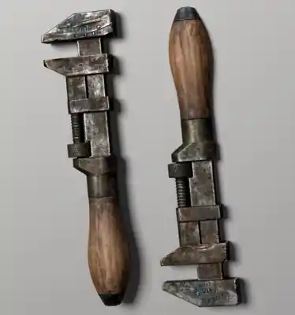

# LORE-002 — Estética de herramientas y objetos manuales

- **Estado:** CANON
- **Tipo:** Objeto / Cultura / Tecnología / Mundo
- **Última revisión:** 2026-10-12

## Resumen

Una **dirección estética general y recurrente** para herramientas de mano y determinados objetos manuales en **Old Scars**: **piezas metálicas usadas, envejecidas o parcialmente oxidadas; mangos de madera; y construcción visualmente utilitaria, robusta y relativamente artesanal**.

Esta dirección comunica objetos con historia de trabajo, mantenimiento y reutilización. **No exige que todas las herramientas tengan la misma apariencia ni estén oxidadas.**

## Referencia visual

*Referencia aportada el 2026-10-12. Se conserva en el repositorio una versión visual optimizada de la imagen. Es una inspiración de formas, acabados y materiales; no un diseño de herramienta obligatorio.*

La imagen presenta dos vistas de una herramienta alargada con mordazas, elementos roscados y ajustes a la vista, superficies de metal con pátina y marcas de uso, pequeños grabados y mango de madera natural.

## Canon establecido: rasgos visuales

### Metal con uso y edad

- Superficies de aspecto férreo o acerado: grises apagados, zonas oscurecidas, arañazos, golpes pequeños, desgaste desigual, manchas y **óxido cuando sea apropiado**.
- Algunas partes pueden verse pulidas por el contacto repetido; otras conservan una pátina más marcada.
- El desgaste sugiere uso prolongado, **no necesariamente daño funcional ni abandono**.

### Madera en zonas de agarre

- Mangos de madera con veta visible, tonos marrones naturales, pequeñas imperfecciones y acabado sobrio.
- Pueden incorporar casquillos, tapas, refuerzos o uniones de metal.
- La madera es una característica visual frecuente de esta familia, **no el único material permitido**.

### Construcción práctica y relativamente artesanal

- Siluetas simples, sólidas y reconocibles; sensación de peso y funcionalidad.
- Tornillos, tuercas, remaches, roscas, abrazaderas, piezas de ajuste y uniones visibles **cuando corresponda al tipo de objeto**.
- Son adecuados detalles discretos de taller, sellos, marcas o reparaciones visibles.
- «Artesanal» describe **el lenguaje visual**, sin establecer que cada herramienta deba fabricarse a mano. Puede coexistir con fabricación industrial.

### Identidad del mundo

La combinación de metal trabajado, madera, pátina y construcción legible debe contribuir a una cultura material sobria, industrial y de oficio. Evitar convertirla en ornamentación medieval gratuita o en maquinaria de fantasía exagerada: el objeto debe seguir pareciendo una herramienta que alguien podría usar.

## Ámbito de aplicación

La referencia puede orientar herramientas de taller, mecánica, mantenimiento, trabajo rural y **otros útiles o elementos manuales de uso práctico seleccionados**.

Su aplicación es **generalizada pero no universal**: edad, procedencia, calidad, conservación y función pueden justificar objetos más nuevos, precisos, refinados, limpios o fabricados con otros materiales. No extiende automáticamente este lenguaje a armas, armaduras, máquinas, instrumental médico ni a todo el equipamiento del universo.

## Límites

- No fija porcentajes de oxidación, materiales exclusivos, técnicas de fabricación o estados de conservación obligatorios.
- No define herramientas concretas que deban existir dentro del juego.
- No introduce mecánicas, ítems, balance, tareas de arte o programación.
- Es **documentación de Lore y dirección visual exclusivamente**, no una entrada de implementación ni de backlog.
